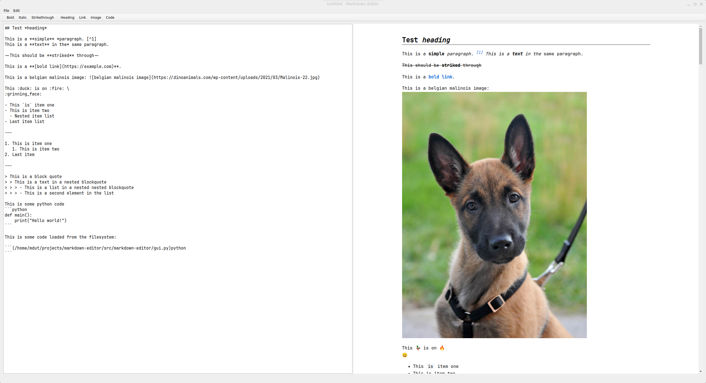

# Markdown Editor

A Markdown editor with graphical user interface and live preview, written in Python.

## Description

Markdown Editor is a desktop application with a custom Markdown parser that offers text editing in Markdown format with live HTML-rendered preview. The project uses PySide6 for the graphical interface and supports extended Markdown features.

## Features

### Markdown Elements Support

- **Headers** (h1-h6)
- **Text Formatting**
  - Bold (`**text**`)
  - Italic (`*text*`)
  - Strikethrough (`~~text~~`)
- **Lists**
  - Ordered lists
  - Unordered lists
  - Nested lists
  - Checkboxes in lists
- **Links and Images**
  - Text links
  - Images (remote and local support)
- **Code Blocks** with syntax highlighting
- **Tables** with column alignment (left, right, center)
- **Blockquotes** with nesting support
- **Footnotes** (`[^1]`)
- **Emoji** (`:emoji_name:`)
- **Horizontal separator** (`---`)
- **Line breaks** (`\` at line end)
- **File Includes** - ability to load code from external files



## Installation

```bash
# Clone the repository
git clone git@github.com:mat-dut/markdown-editor.git
cd markdown-editor

# Install dependencies using uv
uv sync
```

## Usage

### GUI Editor

Run the editor with graphical interface:

```bash
python src/markdown-editor/gui.py
```

## Examples

The `examples/` directory contains sample Markdown files demonstrating various features:

- `example.md` - general example with various elements
- `table.md` - table examples
- `footnotes.md` - footnote examples

## Architecture

The project consists of the following components:

- **Lexer** (`lexer.py`) - Markdown text tokenization
- **Parser** (`parser.py`) - parsing tokens into structural blocks
- **Renderer** (`renderer.py`) - rendering blocks to HTML
- **GUI** (`gui.py`) - graphical interface with live preview
- **Models** - data models for tokens and blocks
